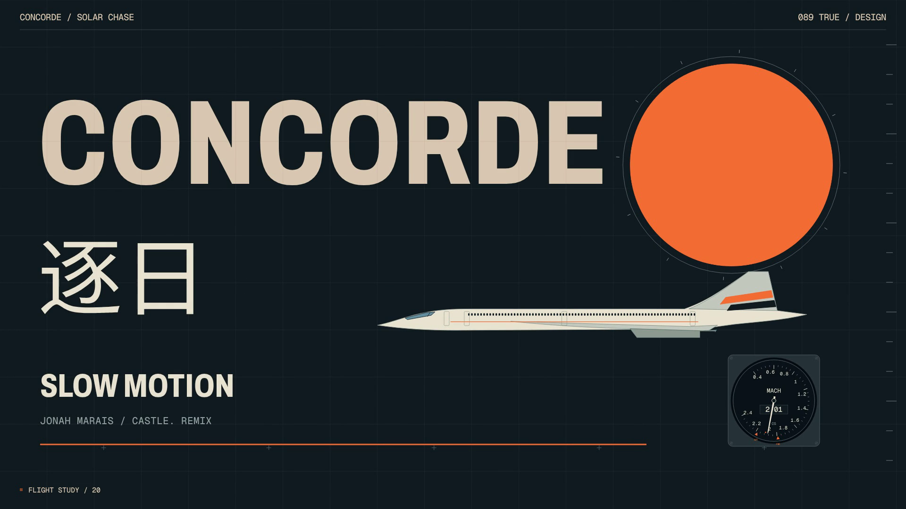

# 逐日 · Concorde Solar Chase

一部关于协和飞机追逐日食的代码动画。以 1973 年 Concorde 001 日食观测任务为背景，将飞行、科学仪器与音乐节奏组织成一个连续镜头世界。

**187 秒 · 1920 × 1080 · 30 fps · 20 章节 · Canvas 2D**

飞机、仪表、日冕和相机均由绝对时间驱动；无需 npm、WebGL 或在线服务。地图使用 Natural Earth 数据。封面直接提取自 v7 成片的最后一帧（第 5,610 帧），没有采用单独生成的封面。

## 这份仓库包含什么

这是 v7 影片的完整可编辑源码，以及为独立仓库整理的播放器、构建器和导出器。它不是补丁，不需要叠加旧版本。

- 影片视觉源码和时间轴保持 v7 原样。
- 默认生成**无声播放器**；可在页面中选择本地配乐，不上传文件。
- 配乐节拍分析数据保留；MP3、内嵌音乐的 HTML 和配乐 MP4 不进入 Git。
- 构建产物在 `build/`，导出产物建议放 `renders/`，两者均被忽略。
- 不附带制作容器的依赖、绝对路径、私人记录或旧版 Git 历史。

## 先看动画

1. 在 Python IDE 中为本项目选择 Python 3.10 或更新版本。
2. 运行 `production/build_player.py`，不需要第三方依赖或额外参数。
3. 用现代桌面浏览器打开生成的 `build/index.html`。点击 **Play** 即可无声播放。
4. 若有本地配乐，使用 **Local soundtrack** 文件选择器加载；它只在当前浏览器会话内生效。

播放器支持播放／暂停、拖动、20 章跳转、0.5×／0.25×速度与全屏。空格播放／暂停，左右键跳转 5 秒；控件获得焦点时保留浏览器的标准按键行为。切到后台会暂停。影片节拍针对原始曲目版本；替换歌曲不会自动重做节拍编排。

## 文档

| 文档 | 内容 |
|---|---|
| [构建、导出与排错](docs/BUILD.md) | 依赖、IDE 运行配置、参数、MP4 导出和地图重建 |
| [编辑与架构](docs/EDITING.md) | 修改入口、时间轴、渲染接口和改动检查 |
| [素材与许可范围](docs/ASSETS.md) | 音乐、字体、地图、机体改绘和借用代码 |
| [来源记录](docs/SOURCES.md) | 史料与视觉参考；保留原版本研究沿革 |
| [设计记录](docs/DESIGN.md) | v7 设计和表现边界 |
| [仓库验收](docs/VALIDATION.md) | 本次便携性、画面一致性和播放器检查 |
| [原影片验收记录](docs/SOURCE_VALIDATION.md) | v7 制作时的检查摘要，不是本次重新全片导出 |

## 工程布局

- `source/`：动画 JS、地理／音频特征／分镜 JSON、SVG、字体及地图纹理。
- `production/`：播放器模板、构建器、地图预处理器和分块视频导出器。
- `raw/`：公开领域地理矢量；可选栅格输入的下载说明及指纹。
- `docs/`：封面、使用／编辑文档、来源与验证记录。

源码公开不等于所有素材适用同一许可证。尤其 `source/motion.js` 沿用 **PolyForm Noncommercial 1.0.0**；不要把整仓库标为 MIT。原作者尚未为项目原创部分指定统一许可，详见 [LICENSE.md](LICENSE.md)。
